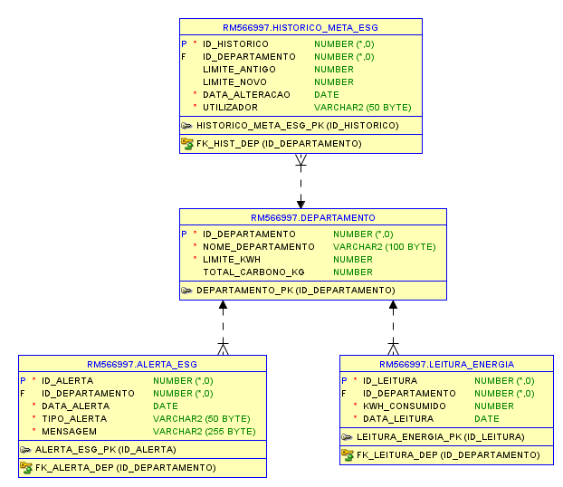
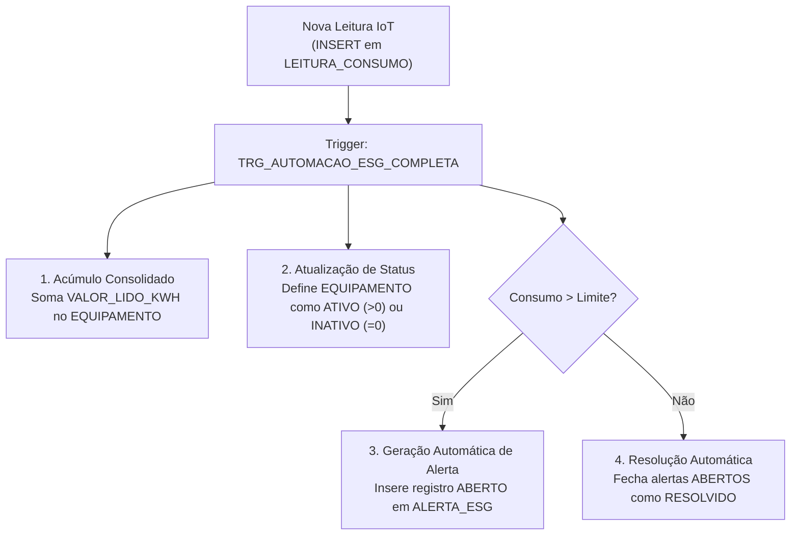

# Automação de Processos ESG e Eficiência Energética com Oracle PL/SQL


**Autor:** Renan Santa Rosa Xavier — RM566997

---

## Sobre o Projeto

Este projeto implementa uma solução automatizada no banco de dados **Oracle (PL/SQL)** voltada ao monitoramento em tempo real de **eficiência energética corporativa e sustentabilidade (ESG)** por meio de sensores IoT prediais.

Toda a regra de negócio crítica é executada diretamente no SGBD através de **Triggers**, garantindo resposta imediata a desvios de consumo energético, atualização automática de equipamentos e consolidação de métricas para auditoria e relatórios ESG.

---

## Modelagem Relacional de Dados (MER)



### Estrutura das Tabelas
- **`LOCALIDADE`**: Mapeia os setores e ambientes monitorados (ex.: Data Center Principal, Andar Corporativo).
- **`EQUIPAMENTO`**: Registra os ativos consumidores de energia, seu `STATUS_ATUAL` (`ATIVO` / `INATIVO`) e o `TOTAL_KWH_ACUMULADO`.
- **`SENSOR_IOT`**: Sensores vinculados a cada equipamento com o `LIMITE_MAX_KWH` parametrizado.
- **`LEITURA_CONSUMO`**: Recebe os fluxos contínuos de medições (`VALOR_LIDO_KWH`) enviadas pelos sensores IoT.
- **`ALERTA_ESG`**: Centraliza os alertas gerados automaticamente por desperdício energético ou anomalias, controlando o ciclo de vida (`ABERTO` / `RESOLVIDO`).

---

## As 4 Automações Implementadas em PL/SQL



1. **Geração Automática de Alerta de Desperdício:** Ao detectar que a leitura em `LEITURA_CONSUMO` ultrapassou o `LIMITE_MAX_KWH` do sensor, o banco cria instantaneamente um alerta em `ALERTA_ESG`.
2. **Atualização Automática de Status do Equipamento:** Atualiza o equipamento para `ATIVO` ou `INATIVO` conforme a leitura dos sensores IoT, mantendo o mapa predial fiel à realidade em tempo real.
3. **Resolução Automática de Alertas:** Evita a fadiga de alarmes fechando automaticamente alertas `ABERTO` assim que o consumo do equipamento retorna aos limites normais.
4. **Acúmulo Consolidado do Consumo de Energia (`TOTAL_KWH_ACUMULADO`):** Soma automaticamente o consumo a cada leitura, disponibilizando o total consolidado instantâneo para dashboards e relatórios ESG sem exigir agregações custosas em tempo de consulta.

---

## Arquivos do Repositório

| Arquivo | Descrição |
| :--- | :--- |
| [`script_banco_esg.sql`](script_banco_esg.sql) | Script completo DDL, Trigger `TRG_AUTOMACAO_ESG_COMPLETA` e massa de testes validando os 4 cenários. |
| [`gerador_pdf_esg.py`](gerador_pdf_esg.py) | Script em Python (`fpdf2`) que gera a documentação técnica e relatório executivo em PDF. |
| [`Relational_1.png`](Relational_1.png) | Diagrama do Modelo Relacional gerado no Oracle SQL Developer Data Modeler. |
| [`atividades_automacao_esg.pdf`](atividades_automacao_esg.pdf) | Documento técnico consolidado com a justificativa das automações e script SQL. |

---

## Como Executar

### 1. Banco de Dados Oracle
Execute o arquivo [`script_banco_esg.sql`](script_banco_esg.sql) no **Oracle SQL Developer** (ou Live SQL). O final do script já inclui os testes de carga (`INSERT`) e consultas (`SELECT`) que demonstram a execução automática da trigger.

### 2. Gerador de Relatório PDF (Python)
```bash
pip install fpdf2
python gerador_pdf_esg.py
```
