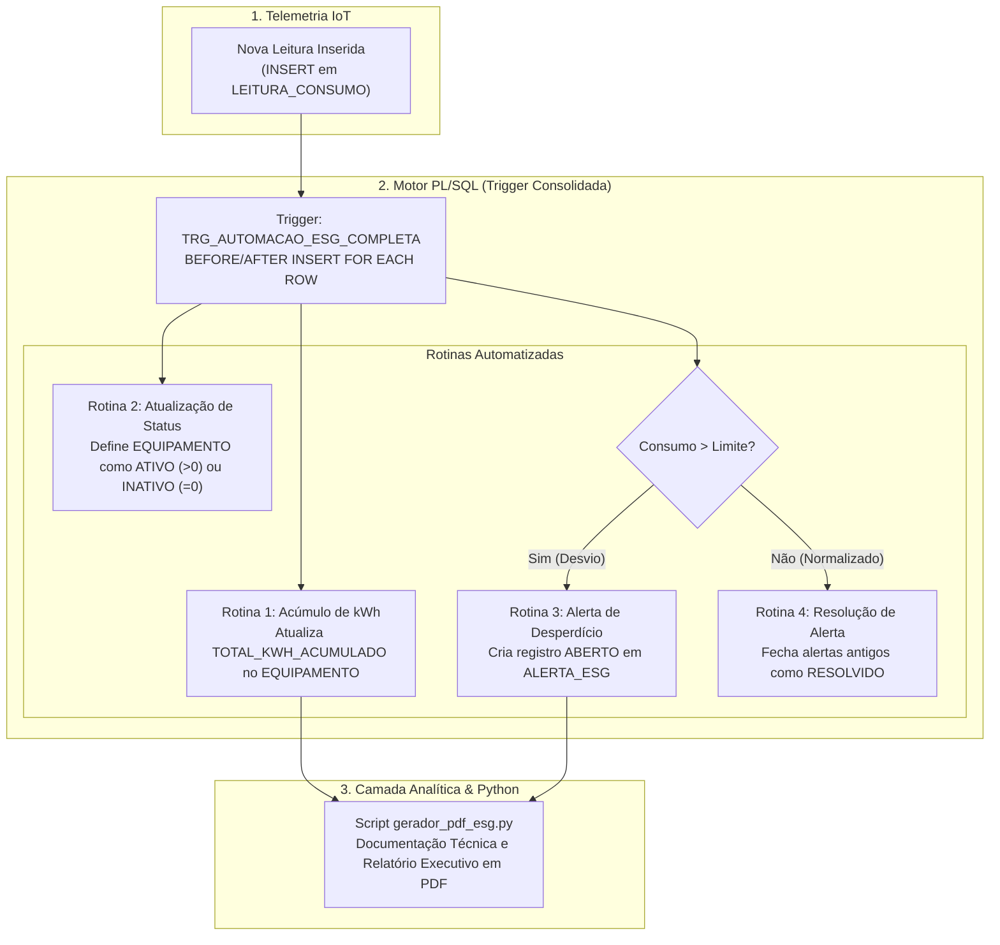

# Automação de Processos ESG e Eficiência Energética com Oracle PL/SQL


[](https://renan-xavier.vercel.app)

**Autor:** Renan Santa Rosa Xavier — RM566997 | 🌐 **Portfólio:** [renan-xavier.vercel.app](https://renan-xavier.vercel.app)  
**Instituição:** FIAP — Análise e Desenvolvimento de Sistemas

---

## 📌 Visão Geral do Projeto

Este projeto implementa uma solução de inteligência analítica em banco de dados **Oracle (PL/SQL)** para monitoramento contínuo de **eficiência energética predial e metas ESG** a partir de medições de sensores IoT.

Em vez de sobrecarregar a camada de aplicação com consultas de agregação repetitivas, as regras de negócio críticas foram delegadas diretamente ao motor do banco de dados por meio da trigger consolidada `TRG_AUTOMACAO_ESG_COMPLETA`. A trigger processa cada leitura inserida, calcula o consumo acumulado, atualiza o status de operação dos equipamentos e emite/encerra alertas de desperdício em tempo real.

---

## 🎬 Demonstração do Sistema

### Diagrama do Modelo Relacional (MER)
Modelagem relacional normalizada com integridade referencial para suportar sensores, leituras e o ciclo de vida dos alertas:


### Estrutura das Tabelas:
* **`LOCALIDADE`**: Setores monitorados (ex.: Data Centers, andares corporativos, plantas fabris).
* **`EQUIPAMENTO`**: Ativos elétricos cadastrados, seu `STATUS_ATUAL` (`ATIVO` / `INATIVO`) e o `TOTAL_KWH_ACUMULADO`.
* **`SENSOR_IOT`**: Dispositivos de telemetria vinculados com `LIMITE_MAX_KWH` parametrizado.
* **`LEITURA_CONSUMO`**: Tabela transacional que recebe as medições brutas (`VALOR_LIDO_KWH`).
* **`ALERTA_ESG`**: Registro automatizado de anomalias com controle de ciclo (`ABERTO` / `RESOLVIDO`).

---

## 🏛️ Arquitetura da Solução

O fluxo transacional executa 4 rotinas automáticas a cada inserção no banco:



---

## 🛠️ Tecnologias Utilizadas

| Tecnologia | Aplicação no Projeto |
| :--- | :--- |
| **Oracle Database & PL/SQL** | Desenvolvimento de triggers complexas, procedures e queries analíticas de alta performance. |
| **Oracle SQL Developer Data Modeler** | Modelagem Lógica e Física do banco relacional com chaves primárias, estrangeiras e constraints de domínio. |
| **Python 3 & fpdf2** | Script de automação para extração de dados e compilação de relatórios técnicos em formato PDF. |
| **SQL DDL & DML** | Scripts de criação das tabelas, sequências, triggers e massa de testes com validação dos 4 cenários. |

---

## 📑 Arquivos do Repositório

| Arquivo | Descrição |
| :--- | :--- |
| [`script_banco_esg.sql`](script_banco_esg.sql) | Script completo contendo DDL, a Trigger `TRG_AUTOMACAO_ESG_COMPLETA` e massa de testes com validação dos 4 cenários operacionais. |
| [`gerador_pdf_esg.py`](gerador_pdf_esg.py) | Script em Python com a biblioteca `fpdf2` para geração de relatórios técnicos executivos. |
| [`Relational_1.png`](Relational_1.png) | Diagrama do Modelo Relacional exportado do Oracle Data Modeler. |
| [`atividades_automacao_esg.pdf`](atividades_automacao_esg.pdf) | Relatório acadêmico completo com a justificativa técnica das automações. |

---

## 🚀 Como Executar

### 1. No Banco de Dados Oracle
1. Abra o **Oracle SQL Developer** (ou Oracle Live SQL).
2. Conecte-se ao seu schema e execute o arquivo [`script_banco_esg.sql`](script_banco_esg.sql).
3. O final do script já inclui testes de inserção e consultas `SELECT` demonstrando as 4 rotinas em execução.

### 2. Gerador de Relatório em Python
```bash
# Instalar a biblioteca fpdf2
pip install fpdf2

# Executar a compilação do relatório PDF
python gerador_pdf_esg.py
```
